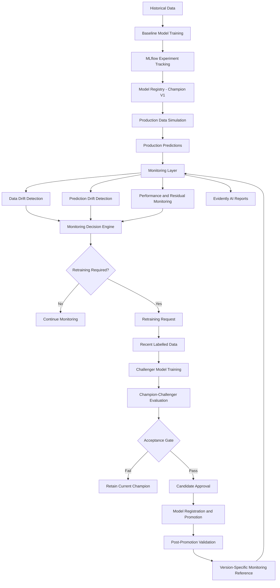

# ML Model Drift Monitoring and Retraining

An end-to-end local MLOps project demonstrating machine learning model monitoring, statistical drift detection, conditional retraining, model governance, versioning and performance recovery using MLflow, Evidently AI and Scikit-learn.

## 1. Project Overview

Machine learning models can experience performance degradation when production data or underlying relationships change over time.

This project simulates a house-price prediction system and demonstrates how to detect, investigate and recover from such degradation through a structured MLOps lifecycle.

The project focuses on:

- Data Drift detection
- Prediction Drift detection
- Concept Drift investigation
- Model performance monitoring
- Statistical hypothesis testing
- Experiment tracking and model registration
- Champion–Challenger evaluation
- Model acceptance and promotion
- Conditional retraining
- Version-specific monitoring references

All datasets are synthetically generated, and the complete implementation runs locally without requiring cloud infrastructure.

## 2. Key Achievements

| Metric | Result |
|---|---:|
| Model recovery MAE reduction | 97.50% |
| Recovered model R² | 0.998287 |
| Recovered model MAE | ₹75,312.30 |
| Registered model versions | 2 |
| Implemented Python scripts | 16 |
| Evidently monitoring scenarios | 3 |
| Conditional retraining tests passed | 3/3 |

## 3. Technology Stack

| Technology | Purpose |
|---|---|
| Python | Core implementation |
| NumPy | Synthetic data generation and numerical operations |
| Pandas | Data processing and report generation |
| Scikit-learn | Linear Regression and model evaluation |
| SciPy | Statistical drift detection |
| MLflow | Experiment tracking, model registration and governance |
| Evidently AI | Automated evaluation and drift reports |
| Joblib | Local model serialization |
| SQLite | Local MLflow backend |
| Matplotlib | Available visualization dependency |
| Git | Source code version control |

## 4. System Architecture



The architecture represents the complete conceptual lifecycle. Initial promotion and the conditional retraining handler are implemented as separate workflows.

## 5. Problem Statement

A Linear Regression model is trained to predict house prices using:

- House size in square feet
- Number of bedrooms
- House age

The original pricing relationship is defined as:

```text
Price = House Size × 4000
      + Bedrooms × 200000
      - House Age × 15000
      + Random Noise
```

The project simulates changing market conditions to evaluate the model's ability to handle distribution shifts and changes in the relationship between input features and house prices.

## 6. Dataset Design

| Dataset | Records | Purpose |
|---|---:|---|
| Historical reference data | 1,000 | Initial model development |
| Monitoring reference V1 | 200 | Historical holdout monitoring |
| Normal production data | 200 | Stable market simulation |
| Data Drift production data | 200 | Input distribution shift |
| Concept Drift production data | 200 | Changed pricing relationship |
| Retraining data | 1,000 | Challenger model development |
| Monitoring reference V2 | 200 | Updated model monitoring baseline |

All datasets are reproducible through seeded random number generation.

## 7. Drift Simulation

### 7.1 Normal Production

The production feature distributions and pricing relationship remain approximately consistent with the historical training environment.

Expected behaviour: stable model performance.

### 7.2 Data Drift

House sizes change from the historical range of approximately 800–2,200 square feet to 2,200–3,600 square feet.

The underlying pricing relationship remains unchanged.

Expected behaviour:

- Input distribution drift
- Prediction distribution drift
- No major model performance degradation

### 7.3 Prediction Drift

Prediction Drift is monitored by comparing historical and production prediction distributions.

In the Data Drift scenario, larger houses naturally produce higher predicted prices.

Prediction Drift does not necessarily indicate that the model has become inaccurate.

### 7.4 Concept Drift

The underlying pricing relationship changes from ₹4,000 per square foot to ₹6,000 per square foot.

```text
New Price = House Size × 6000
          + Bedrooms × 200000
          - House Age × 15000
          + Random Noise
```

Input feature distributions remain approximately unchanged, but the existing model becomes inaccurate because it has learned the previous pricing relationship.

## 8. Baseline Model Training

The original model uses Linear Regression with an 80:20 training and testing split.

### Baseline Results

| Metric | Value |
|---|---:|
| Training samples | 800 |
| Testing samples | 200 |
| MAE | ₹78,612.08 |
| RMSE | ₹96,811.56 |
| R² | 0.996570 |

The model is tracked and registered in MLflow as `HousePriceDriftModel`, Version 1.

## 9. Production Monitoring Results

| Scenario | MAE | RMSE | R² |
|---|---:|---:|---:|
| Normal | ₹81,566.22 | ₹1,01,976.35 | 0.995744 |
| Data Drift | ₹86,076.42 | ₹1,07,236.69 | 0.996028 |
| Concept Drift | ₹30,11,001.05 | ₹31,15,426.13 | -0.741726 |

The results demonstrate that distribution drift does not always cause major performance degradation, whereas a change in the underlying pricing relationship can significantly degrade predictions.

## 10. Statistical Drift Detection

The following statistical tests are implemented:

| Monitoring component | Method |
|---|---|
| Numerical feature drift | Kolmogorov–Smirnov two-sample test |
| Categorical feature drift | Chi-square test |
| Prediction drift | Kolmogorov–Smirnov test |
| Residual drift | Kolmogorov–Smirnov test |
| Potential Concept Drift | Combined performance and residual monitoring |

The statistical significance threshold is set to 0.05 for this demonstration.

### Drift Detection Results

| Indicator | Normal | Data Drift | Concept Drift |
|---|---|---|---|
| Input drift | No | Yes | No |
| Prediction drift | No | Yes | No |
| Residual drift | No | Yes | Yes |
| Significant performance degradation | No | No | Yes |
| Potential Concept Drift alert | No | No | Yes |

Potential Concept Drift is identified using a combination of performance degradation and residual or R² changes. These indicators are investigative signals rather than definitive proof of Concept Drift in real production environments.

## 11. Evidently AI Monitoring

Evidently AI is used to generate automated monitoring reports containing:

- Feature distribution comparisons
- Dataset-level drift
- Prediction distribution comparisons
- Target distribution changes
- Regression performance metrics
- Error distributions

### Actual Dataset Drift Results

| Scenario | Drifted Columns | Dataset Drift |
|---|---:|---|
| Normal | 0/5 | No |
| Data Drift | 3/5 | Yes |
| Concept Drift | 1/5 | No |

The default dataset drift threshold is 50%.

This demonstrates why dataset-level drift alone is insufficient to determine whether a model remains healthy.

HTML and JSON reports can be generated locally for all three scenarios.

## 12. MLflow Experiment Tracking

MLflow tracks:

- Model parameters
- Evaluation metrics
- Model coefficients
- Experiment tags
- Prediction artifacts
- Evaluation reports
- Model signatures and input examples
- Registered model versions
- Promotion decisions
- Retraining and monitoring results

Experiment name:

```text
HousePriceDriftMonitoring
```

Registered model name:

```text
HousePriceDriftModel
```

## 13. Champion–Challenger Retraining

A new Linear Regression model is trained using 800 recent labelled samples and evaluated using 200 unseen holdout samples.

Both the existing champion and the challenger are evaluated on the same holdout dataset.

| Metric | Champion V1 | Challenger |
|---|---:|---:|
| MAE | ₹30,03,007.11 | ₹79,957.94 |
| RMSE | ₹31,16,317.22 | ₹1,00,684.94 |
| R² | -0.552450 | 0.998379 |

The challenger achieves a 97.34% reduction in MAE.

### Learned Pricing Coefficients

| Feature | Version 1 | Challenger |
|---|---:|---:|
| House size | 3987.38 | 5989.34 |
| Bedrooms | 202120.69 | 195685.32 |
| House age | -14494.81 | -14149.19 |

The challenger successfully learns the new pricing relationship.

## 14. Model Acceptance Gate

A candidate must satisfy all three acceptance conditions:

| Criterion | Threshold | Actual Result |
|---|---:|---:|
| MAE improvement | At least 20% | 97.34% |
| Challenger MAE | At most ₹1,50,000 | ₹79,957.94 |
| Challenger R² | At least 0.95 | 0.998379 |

All acceptance conditions passed.

The thresholds are illustrative policies selected for this synthetic regression problem.

## 15. Model Registration and Promotion

After successful evaluation, the challenger is registered as Version 2 in MLflow.

The model registry aliases are updated as follows:

```text
HousePriceDriftModel
    ├── Version 1 → previous_champion
    └── Version 2 → champion
```

The previous model is preserved for potential rollback.

Registered model inference is also verified to ensure predictions remain consistent after serialization.

## 16. Post-Promotion Validation

Both registered model versions are evaluated against the production dataset that originally triggered the Concept Drift alert.

This dataset was not used to train the challenger.

| Metric | Version 1 | Version 2 |
|---|---:|---:|
| MAE | ₹30,11,001.05 | ₹75,312.30 |
| RMSE | ₹31,15,426.13 | ₹97,708.14 |
| R² | -0.741726 | 0.998287 |
| Mean signed error | ₹30,11,001.05 | ₹5,022.10 |

**Model recovery: Successful**

**MAE reduction: 97.50%**

The validation dataset was previously used for drift investigation and should not be considered a completely blind production test.

## 17. Version-Specific Monitoring References

Separate monitoring references are maintained for each promoted model.

| Model | Monitoring Reference | Baseline Metrics |
|---|---|---|
| V1 | monitoring_reference.csv | baseline_metrics.json |
| V2 | monitoring_reference_v2.csv | baseline_metrics_v2.json |

This prevents the new model from being monitored against an inappropriate historical performance baseline.

## 18. Automated Monitoring Pipeline

The monitoring pipeline dynamically:

1. Identifies the current champion version.
2. Loads its registered model.
3. Loads the corresponding monitoring reference.
4. Validates incoming labelled data.
5. Generates predictions.
6. Calculates regression performance metrics.
7. Performs statistical drift detection.
8. Determines the monitoring action.
9. Logs results to MLflow.
10. Generates structured monitoring reports.

### Monitoring Decisions

| Decision | Meaning |
|---|---|
| CONTINUE_MONITORING | Model remains healthy |
| MONITORING_ALERT | Distribution changes require investigation |
| INVESTIGATE_PERFORMANCE | Performance degradation requires investigation |
| RETRAINING_REQUIRED | Potential Concept Drift warrants retraining investigation |

### Verified Pipeline Results

| Scenario | Champion | MAE | Decision |
|---|---|---:|---|
| Current market | V2 | ₹75,312.30 | CONTINUE_MONITORING |
| Simulated market reversal | V2 | ₹31,05,360.24 | RETRAINING_REQUIRED |

## 19. Conditional Retraining Workflow

The retraining handler validates the monitoring report, verifies the active champion version and checks whether recent labelled training data is available.

### Verified Test Cases

| Test | Result |
|---|---|
| Healthy model | Retraining skipped |
| Degraded model without training data | WAITING_FOR_TRAINING_DATA |
| Challenger without improvement | CANDIDATE_REJECTED |

During the rejection test, both models achieved an MAE of ₹79,957.94. Since the challenger provided no performance improvement, it was rejected and Version 2 remained the champion.

The handler supports logging an accepted candidate for approval, but that particular execution branch has not yet been tested.

## 20. Project Structure

```text
ml-model-drift-monitoring/
├── data/
├── models/
├── reports/
│   ├── evidently/
│   ├── pipeline/
│   └── retraining_requests/
├── scripts/
│   ├── generate_reference_data.py
│   ├── train_baseline.py
│   ├── verify_registry.py
│   ├── generate_production_data.py
│   ├── evaluate_production.py
│   ├── detect_data_drift.py
│   ├── detect_prediction_drift.py
│   ├── detect_concept_drift.py
│   ├── generate_evidently_reports.py
│   ├── generate_retraining_data.py
│   ├── retrain_model.py
│   ├── register_challenger.py
│   ├── validate_promoted_model.py
│   ├── update_monitoring_reference.py
│   ├── monitoring_pipeline.py
│   └── retraining_trigger.py
├── .gitignore
├── requirements.txt
└── README.md
```

Generated datasets, serialized models, local MLflow databases and runtime artifacts are excluded from version control. They can be recreated by executing the project scripts.

## 21. Local Installation

Create a virtual environment:

```bash
python3 -m venv .venv
```

Activate the environment on macOS or Linux:

```bash
source .venv/bin/activate
```

Install dependencies:

```bash
python -m pip install -r requirements.txt
```

Create required directories:

```bash
mkdir -p data models reports
```

The project was developed and verified using Python 3.9.6 on macOS without administrator privileges. Python 3.9 is now end-of-life; a supported Python version is recommended for further development after dependency compatibility verification.

## 22. Execution Instructions

Execute the following commands sequentially using a fresh MLflow registry.

### Phase 1 — Baseline Model

```bash
python scripts/generate_reference_data.py
python scripts/train_baseline.py
python scripts/verify_registry.py
```

### Phase 2 — Production Simulation

```bash
python scripts/generate_production_data.py
python scripts/evaluate_production.py
```

### Phase 3 — Drift Monitoring

```bash
python scripts/detect_data_drift.py
python scripts/detect_prediction_drift.py
python scripts/detect_concept_drift.py
python scripts/generate_evidently_reports.py
```

### Phase 4 — Retraining and Model Promotion

```bash
python scripts/generate_retraining_data.py
python scripts/retrain_model.py
python scripts/register_challenger.py
python scripts/validate_promoted_model.py
python scripts/update_monitoring_reference.py
```

The registration and promotion scripts are designed for the demonstrated Version 1 to Version 2 transition. Avoid rerunning them indiscriminately against an already promoted registry.

### Phase 5 — Automated Monitoring

```bash
python scripts/monitoring_pipeline.py \
    --dataset production_concept_drift.csv
```

```bash
python scripts/monitoring_pipeline.py \
    --dataset production_normal.csv
```

### Phase 6 — Conditional Retraining

Use the generated monitoring summary JSON file:

```bash
python scripts/retraining_trigger.py \
    --report reports/pipeline/<summary-file>.json
```

Supply an explicitly selected recent labelled training dataset when available:

```bash
python scripts/retraining_trigger.py \
    --report reports/pipeline/<summary-file>.json \
    --training-data retraining_data.csv
```

Replace the summary filename placeholder with the actual generated filename.

## 23. MLflow Dashboard

Start the local MLflow UI:

```bash
mlflow ui \
    --backend-store-uri sqlite:///mlflow.db \
    --host 127.0.0.1 \
    --port 5001
```

Open:

http://localhost:5001

The dashboard provides access to experiment runs, parameters, metrics, artifacts and registered model versions.

## 24. Evidently Reports

Generate the reports:

```bash
python scripts/generate_evidently_reports.py
```

On macOS, open the reports using:

```bash
open reports/evidently/normal_report.html
open reports/evidently/data_drift_report.html
open reports/evidently/concept_drift_report.html
```

## 25. Key Learnings

- Data Drift does not necessarily indicate model degradation.
- Prediction Drift does not independently prove Concept Drift.
- Residual drift can occur without a change in the underlying relationship.
- Model performance must be monitored alongside statistical distribution changes.
- Retraining must use relevant and validated labelled data.
- Champion–Challenger evaluation supports evidence-based model selection.
- A model should only be promoted after satisfying defined acceptance criteria.
- Previous model versions should remain available for rollback.
- Monitoring references should be associated with the corresponding model version.
- Retraining triggers should not blindly initiate model promotion.

## 26. Limitations and Future Enhancements

This project is a controlled local MLOps simulation rather than a production-deployed system.

Potential improvements include:

- Scheduled monitoring using Apache Airflow
- Data validation using Pandera or Great Expectations
- Data and artifact versioning using DVC
- Production inference API
- Centralized monitoring and alert notifications
- Automatic rollback safeguards
- Independent candidate approval workflow
- Duplicate retraining request prevention
- Data provenance and freshness validation
- Statistical multiple-testing correction
- Monitoring with delayed ground-truth labels
- Continuous integration and automated tests

## 27. Conclusion

This project demonstrates an end-to-end machine learning monitoring and recovery lifecycle, beginning with baseline model development and extending through statistical drift detection, experiment tracking, controlled retraining, model registration, promotion and post-promotion validation.

The implementation successfully recovered a model affected by simulated Concept Drift, achieving a 97.50% reduction in mean absolute error while maintaining model versioning and conditional retraining safeguards.